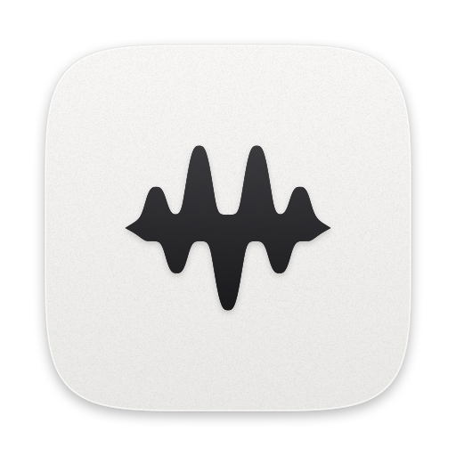

<p align="center">
  <picture>
    <source media="(prefers-color-scheme: dark)" srcset="brand/logo-dark.png">
    
  </picture>
</p>

<p align="center">
  <b>Every app’s volume, your way.</b><br>
  Per-app volume, mute and audio output, right from your Mac’s menu bar.
</p>

<p align="center">
  <a href="https://github.com/murilocicuti/audioprime/releases/latest"></a>
  
  
  <a href="LICENSE"></a>
</p>

<p align="center">
  
</p>

<p align="center">
  <b>English</b> · <a href="README.pt-BR.md">Português</a>
</p>

---

## What it does

- **Per-app volume:** keep the music low and the call loud, at the same time.
- **Per-app mute:** silence just that one noisy app.
- **Per-app output:** music on your headphones, video on your speakers.
- **System volume and output** in the same panel.
- **Light and discreet:** lives only in the menu bar, never in the Dock. The icon gives a gentle wave when an
  app starts playing.
- **Speaks your language:** English, Português, Deutsch and Español, following your Mac’s language.
- **Private:** audio is processed live on your Mac. Nothing is recorded, saved or uploaded. No account, no ads.

## Compatibility

| macOS | Status |
|---|---|
| macOS 26 Tahoe | ✅ Supported and tested |
| macOS 15 Sequoia | ✅ Supported |
| macOS 14.4 – 14.7 Sonoma | ✅ Supported |
| macOS 14.3 or earlier | ❌ Not supported: it lacks the system feature that allows per-app audio control |

Runs on Macs with **Apple Silicon (M1, M2, M3, M4…)** and **Intel**.
To check your version: Apple menu  › **About This Mac**.

## Install

### Option 1 — One command (recommended)

1. Open **Terminal**: press `⌘ Command` + `Space`, type **Terminal** and press `Return`.
2. Copy the line below, paste it into Terminal (`⌘ Command` + `V`) and press `Return`:

   ```bash
   curl -fsSL https://raw.githubusercontent.com/murilocicuti/audioprime/main/install.sh | bash
   ```

3. Done. The installer checks that your Mac is compatible, downloads the latest version, puts AudioPrime in
   your **Applications** folder and opens it. You can close Terminal.

> No password needed. If you aren’t an administrator on this Mac, the app goes into your personal
> Applications folder instead.

### Option 2 — Manual download

1. Download **AudioPrime.zip** from the [releases page](https://github.com/murilocicuti/audioprime/releases/latest)
   and double-click it to unzip.
2. Drag **AudioPrime** into your **Applications** folder.
3. Open the app. Because it’s free and not signed by Apple, macOS shows a warning. Click **Done** (or **OK**).
4. Open **System Settings › Privacy & Security**, scroll down to the message about AudioPrime and click
   **Open Anyway**. Confirm with your password or Touch ID. You only need to do this once.

## First use

1. Click the wave icon in the **menu bar**, at the top right of your screen.
2. Play something in any app (Spotify, YouTube, Music…). It shows up in the list.
3. Move that app’s volume slider. The first time, macOS asks whether AudioPrime may access system audio:
   click **Allow**.
4. Want it to start on its own? Check **Open at login** in the panel.

If you denied the permission by mistake, turn AudioPrime on in
**System Settings › Privacy & Security › Screen & System Audio Recording**.
AudioPrime doesn’t record anything: macOS just uses that name for the audio-capture permission.

## Update and uninstall

- **Update:** run the install command again. It quits the app, swaps in the new version and reopens it.
  After an update, macOS may ask for the audio permission again.
- **Uninstall:** run the command below. It quits the app and removes AudioPrime and its preferences.

  ```bash
  curl -fsSL https://raw.githubusercontent.com/murilocicuti/audioprime/main/install.sh | bash -s -- --uninstall
  ```

## Plays nicely with your Mac

AudioPrime is built to stay out of the way:

- **Only steps in when you ask.** An app at 100% volume, not muted, on the default output plays normally,
  without going through AudioPrime.
- **Leaves nothing behind.** The audio resources it creates exist only while it’s running. If you quit it
  (or it closes for any reason), every app goes back to playing normally.
- **Creates no visible audio devices** and doesn’t change your devices.
- **One instance only:** opening it twice doesn’t duplicate anything.
- **Sleeps with your Mac:** releases audio before sleep and resumes on wake.
- **Warns about conflicts:** if another per-app audio mixer is running (such as SoundSource, Background Music
  or eqMac), the panel shows a notice. Use one at a time.
- **Respects Reduce Motion:** with that accessibility setting on, the menu bar icon doesn’t animate.

## FAQ

<details>
<summary><b>An app went silent. What now?</b></summary>

Turn AudioPrime off with the switch at the top of the panel. If the sound doesn’t come back, quit AudioPrime
(**Quit** button) and reopen the silent app. Then check the permission in
**System Settings › Privacy & Security › Screen & System Audio Recording**.
</details>

<details>
<summary><b>Why isn’t an app in the list?</b></summary>

The list shows apps that are playing audio right now, or that you’ve already adjusted. Press play and it
shows up.
</details>

<details>
<summary><b>Does it work with every app?</b></summary>

Protected content (some streaming services) and apps that take exclusive control of an audio device may not
be controllable. AudioPrime works with stereo audio.
</details>

<details>
<summary><b>Why does macOS say it can’t verify the developer?</b></summary>

Apple charges US$ 99 a year to avoid that warning. AudioPrime is free, so we’d rather not charge anyone. The
code is open: anyone can check what the app does. The Option 1 installer avoids the warning.
</details>

## For developers

```bash
git clone https://github.com/murilocicuti/audioprime.git
cd audioprime
./scripts/run.sh      # builds the universal app, quits the running copy and opens the new one
./scripts/brand.sh    # regenerates the app icon and the brand files in brand/
```

No Xcode required: everything builds with `swiftc` from the Command Line Tools. To publish a release, push a
tag (`git tag v0.4.0 && git push origin v0.4.0`). GitHub Actions builds and publishes `AudioPrime.zip`,
which is what the installer downloads.

Translations live in `Resources/<language>.lproj/`. To add a language, copy `en.lproj`, translate the values
and add the language code to `CFBundleLocalizations` in `Resources/Info.plist`.

<details>
<summary><b>How it works</b></summary>

- `AudioProcesses` lists Core Audio process objects and groups helpers (browser tabs, renderers) under the
  app that launched them.
- `AppTap` creates, for each adjusted app, a private *process tap* (`CATapDescription`) and a private
  aggregate device with the chosen output. An IOProc copies the audio, applying gain with a smooth ramp.
- `MixerStore` keeps per-app settings and only keeps taps for apps that aren’t at their defaults.
- `WaveMark` draws the logo. The same code produces the menu bar icon (and its animation), the app icon and
  the files in `brand/`.
</details>

## Credits

Created by **Murilo Cicuti** · [LinkedIn](https://www.linkedin.com/in/murilocicuti)

Released under the [MIT License](LICENSE).
