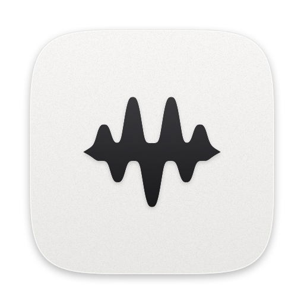

<p align="center">
  <picture>
    <source media="(prefers-color-scheme: dark)" srcset="brand/logo-dark.png">
    
  </picture>
</p>

<p align="center">
  <b>O volume de cada app, do seu jeito.</b><br>
  Volume, mudo e saída de áudio individuais para cada app, direto da barra de menus do Mac.
</p>

<p align="center">
  <a href="https://github.com/murilocicuti/audioprime/releases/latest"></a>
  
  
  <a href="LICENSE"></a>
</p>

<p align="center">
  
</p>

<p align="center">
  <a href="README.md">English</a> · <b>Português</b>
</p>

---

## O que ele faz

- **Volume por app:** deixe a música baixinha e a chamada alta, ao mesmo tempo.
- **Mudo por app:** silencie só aquele app barulhento.
- **Saída por app:** música no fone, vídeo na caixa de som.
- **Volume e saída do sistema** no mesmo painel.
- **Leve e discreto:** vive só na barra de menus e não aparece no Dock. O ícone faz uma ondulação suave
  quando um app começa a tocar.
- **Fala a sua língua:** português, inglês, alemão e espanhol, seguindo o idioma do seu Mac.
- **Privado:** o áudio é processado ao vivo no seu Mac. Nada é gravado, salvo ou enviado. Sem conta, sem anúncios.

## Compatibilidade

| macOS | Situação |
|---|---|
| macOS 26 Tahoe | ✅ Suportado e testado |
| macOS 15 Sequoia | ✅ Suportado |
| macOS 14.4 a 14.7 Sonoma | ✅ Suportado |
| macOS 14.3 ou anterior | ❌ Não funciona: falta o recurso do sistema que permite controlar o áudio de cada app |

Roda em Macs com **Apple Silicon (M1, M2, M3, M4…)** e com **Intel**.
Para ver sua versão: menu  › **Sobre Este Mac**.

## Como instalar

### Opção 1 — Um comando (recomendada)

1. Abra o **Terminal**: pressione `⌘ Command` + `Espaço`, digite **Terminal** e tecle `Enter`.
2. Copie a linha abaixo, cole no Terminal (`⌘ Command` + `V`) e tecle `Enter`:

   ```bash
   curl -fsSL https://raw.githubusercontent.com/murilocicuti/audioprime/main/install.sh | bash
   ```

3. Pronto. O instalador confere se seu Mac é compatível, baixa a versão mais recente, coloca o
   AudioPrime na pasta **Aplicativos** e o abre. Pode fechar o Terminal.

> Não precisa digitar senha. Se você não for administrador do Mac, o app é instalado na sua pasta
> pessoal de Aplicativos.

### Opção 2 — Baixar manualmente

1. Baixe o **AudioPrime.zip** na [página de versões](https://github.com/murilocicuti/audioprime/releases/latest)
   e dê dois cliques nele para descompactar.
2. Arraste o **AudioPrime** para a pasta **Aplicativos**.
3. Abra o app. Como ele é gratuito e não é assinado pela Apple, o macOS mostra um aviso. Clique em **OK**.
4. Abra **Ajustes do Sistema › Privacidade e Segurança**, role até o aviso sobre o AudioPrime e clique em
   **Abrir mesmo assim**. Confirme com sua senha ou Touch ID. Isso só é necessário na primeira vez.

## Primeiro uso

1. Clique no ícone de onda na **barra de menus**, no canto superior direito da tela.
2. Toque algo em qualquer app (Spotify, YouTube, Música…). Ele aparece na lista.
3. Mexa no volume desse app. Na primeira vez, o macOS pergunta se o AudioPrime pode acessar o áudio do
   sistema: clique em **Permitir**.
4. Quer que ele abra sozinho? Marque **Abrir ao iniciar sessão** no painel.

Se você recusou a permissão sem querer, ative o AudioPrime em
**Ajustes do Sistema › Privacidade e Segurança › Gravação de Tela e Áudio do Sistema**.
O AudioPrime não grava nada: o macOS só usa esse nome para a permissão de captura de áudio.

## Atualizar e desinstalar

- **Atualizar:** rode o mesmo comando da instalação. Ele fecha o app, troca pela versão nova e abre de novo.
  Após uma atualização, o macOS pode pedir a permissão de áudio outra vez.
- **Desinstalar:** rode o comando abaixo. Ele fecha o app, apaga o AudioPrime e as preferências dele.

  ```bash
  curl -fsSL https://raw.githubusercontent.com/murilocicuti/audioprime/main/install.sh | bash -s -- --uninstall
  ```

## Convivendo bem com o seu Mac

O AudioPrime foi feito para não atrapalhar o resto do sistema:

- **Só entra em ação quando você pede.** Um app com volume 100%, sem mudo e na saída padrão toca normalmente,
  sem passar pelo AudioPrime.
- **Nada fica para trás.** Os recursos de áudio que ele cria existem só enquanto ele está aberto. Se você
  sair do app (ou ele fechar por qualquer motivo), todos os apps voltam a tocar normalmente.
- **Não cria dispositivos de áudio visíveis** e não altera os seus dispositivos.
- **Uma instância só:** abrir o app duas vezes não duplica nada.
- **Repousa junto com o Mac:** libera o áudio antes do repouso e retoma ao acordar.
- **Avisa sobre conflitos:** se outro mixer de áudio por app estiver aberto (como SoundSource, Background
  Music ou eqMac), o painel mostra um aviso. Use um de cada vez.
- **Respeita "Reduzir movimento":** com esse ajuste de acessibilidade ativo, o ícone da barra de menus não
  se anima.

## Dúvidas comuns

<details>
<summary><b>Um app ficou mudo. E agora?</b></summary>

Desligue o AudioPrime no botão do topo do painel. Se o som não voltar, saia do AudioPrime (botão **Sair**)
e abra o app que estava mudo de novo. Depois confira a permissão em
**Ajustes do Sistema › Privacidade e Segurança › Gravação de Tela e Áudio do Sistema**.
</details>

<details>
<summary><b>Por que um app não aparece na lista?</b></summary>

A lista mostra apps que estão tocando áudio agora, ou que você já ajustou. Dê play em algo e ele aparece.
</details>

<details>
<summary><b>Algum app não funciona?</b></summary>

Conteúdo protegido (alguns serviços de streaming) e apps que usam o dispositivo de áudio de forma
exclusiva podem não ser controlados. O AudioPrime trabalha com áudio estéreo.
</details>

<details>
<summary><b>Por que o macOS avisa que não pode verificar o desenvolvedor?</b></summary>

Para não mostrar esse aviso, a Apple cobra US$ 99 por ano. O AudioPrime é gratuito, então preferimos não
cobrar ninguém. O código é aberto: qualquer pessoa pode conferir o que o app faz. O instalador da Opção 1
evita o aviso.
</details>

## Para desenvolvedores

```bash
git clone https://github.com/murilocicuti/audioprime.git
cd audioprime
./scripts/run.sh      # compila o app universal, fecha a instância aberta e abre a nova
./scripts/brand.sh    # regenera o ícone e os arquivos de identidade em brand/
```

Não precisa de Xcode: tudo compila com `swiftc` das Command Line Tools. Para publicar uma versão, envie uma
tag (`git tag v0.4.0 && git push origin v0.4.0`). O GitHub Actions compila e publica o `AudioPrime.zip`,
que é o que o instalador baixa.

As traduções ficam em `Resources/<idioma>.lproj/`. Para adicionar um idioma, copie `en.lproj`, traduza os
valores e inclua o código do idioma em `CFBundleLocalizations` no `Resources/Info.plist`.

<details>
<summary><b>Como funciona por dentro</b></summary>

- `AudioProcesses` lista os processos de áudio do Core Audio e agrupa os auxiliares (abas de navegador,
  renderizadores) no app que os abriu.
- `AppTap` cria, para cada app ajustado, um *process tap* privado (`CATapDescription`) e um dispositivo
  agregado privado com a saída escolhida. Um IOProc copia o áudio aplicando o ganho com rampa suave.
- `MixerStore` guarda os ajustes por app e só mantém taps para apps fora do padrão.
- `WaveMark` desenha a marca. O mesmo código gera o ícone da barra de menus (e a animação dele), o ícone do
  app e os arquivos em `brand/`.
</details>

## Créditos

Criado por **Murilo Cicuti** · [LinkedIn](https://www.linkedin.com/in/murilocicuti)

Distribuído sob a [licença MIT](LICENSE).
